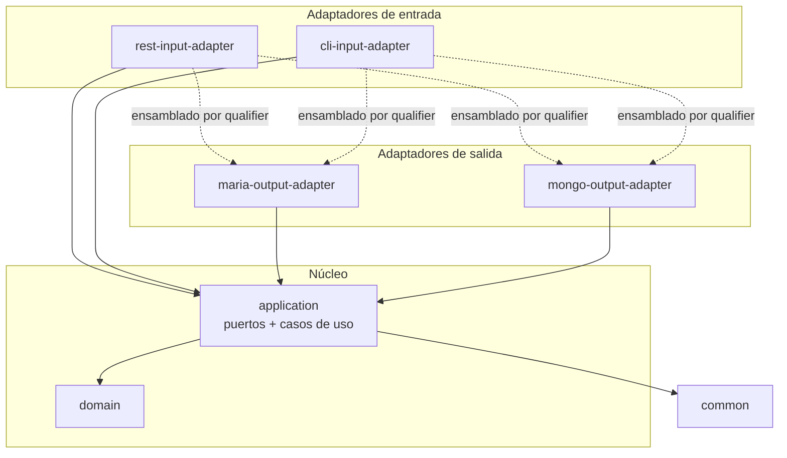
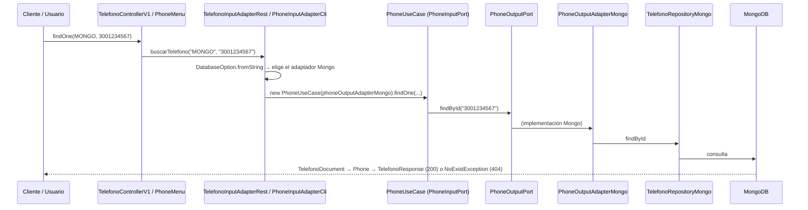
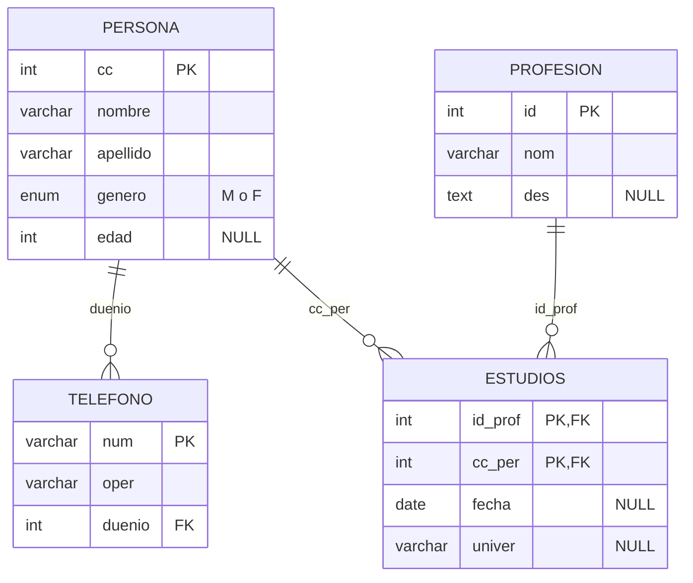

# PersonAPP — Servicio web hexagonal con Repository y Service

[](https://github.com/samueldazag2/personapp-hexa-spring-boot/actions/workflows/ci.yml)

Laboratorio 2 de Arquitectura de Software — Pontificia Universidad Javeriana.
*Implementación de Servicio WEB en Hexagonal con Repository y Service.*

PersonAPP expone el CRUD de **persona**, **profesión**, **estudio** y **teléfono** por **REST** (con
Swagger 3) y por **CLI**, y guarda los datos en **MariaDB** o en **MongoDB**: cada operación elige la
base (`MARIA` o `MONGO`). El núcleo (dominio y casos de uso) no conoce ni la base de datos ni la forma
de entrada; los adaptadores se conectan a él por medio de puertos.

| | |
|---|---|
| Lenguaje | Java 11 (`maven.compiler.release=11`) |
| Framework | Spring Boot 2.7.18 (Web, Data JPA, Data MongoDB) |
| Bases de datos | MariaDB 10.11 y MongoDB 6.0 |
| Entradas | REST (puerto 3000) y CLI |
| Documentación API | Swagger 3 / OpenAPI (springdoc-openapi 1.7.0) |
| Build | Maven multi-módulo |
| Despliegue | Docker multi-stage + Docker Compose |

**Equipo:** Samuel Daza, Sara Muñoz, Samuel José Velandia.

## Contenido

1. [Arquitectura](#arquitectura)
2. [Modelo de datos](#modelo-de-datos)
3. [Requisitos](#requisitos)
4. [Configuración del ambiente](#configuración-del-ambiente)
5. [Compilación](#compilación)
6. [Despliegue](#despliegue)
7. [Ejecución de REST y CLI](#ejecución-de-rest-y-cli)
8. [Endpoints REST](#endpoints-rest)
9. [Swagger](#swagger)
10. [Scripts DDL y DML](#scripts-ddl-y-dml)
11. [Pruebas](#pruebas)
12. [Matriz de verificación](#matriz-de-verificación)
13. [Estructura del repositorio](#estructura-del-repositorio)

## Arquitectura

Arquitectura hexagonal (puertos y adaptadores) en 7 módulos Maven. Las dependencias apuntan hacia el
núcleo: `domain` no depende de nada (solo Lombok), `application` depende de `domain` y `common`, y los
adaptadores dependen de `application`.

| Módulo | Capa | Responsabilidad |
|---|---|---|
| `common` | Transversal | Anotaciones (`@UseCase`, `@Adapter`, `@Mapper`, `@Port`), excepciones (`NoExistException`, `InvalidOptionException`, `AlreadyExistsException`) y `DatabaseOption`. |
| `domain` | Núcleo | Modelo puro: `Person`, `Profession`, `Study`, `Phone`, `Gender`. Sin Spring. |
| `application` | Núcleo | Puertos de entrada (`*InputPort`) y salida (`*OutputPort`) y casos de uso (`*UseCase`, patrón **Service**). |
| `maria-output-adapter` | Adaptador de salida | Entidades JPA, mappers y repositorios Spring Data JPA (patrón **Repository**). |
| `mongo-output-adapter` | Adaptador de salida | Documentos, mappers y repositorios Spring Data MongoDB (patrón **Repository**). |
| `rest-input-adapter` | Adaptador de entrada | Controladores REST, adaptadores de entrada, mappers, DTOs, manejo de errores y Swagger. |
| `cli-input-adapter` | Adaptador de entrada | Menús de consola, adaptadores de entrada y mappers. |



Flujo de cada función (ejemplo: `GET /api/v1/telefono/MONGO/3001234567`). Ningún controlador ni menú
llama repositorios ni adaptadores de salida directamente:



Decisiones de diseño:

- **Selección de base por petición.** El adaptador de entrada convierte el texto (`maria`, `MONGO`…) con
  `DatabaseOption.fromString` y crea el caso de uso con el adaptador de salida correspondiente. En REST
  el caso de uso es una variable local de cada petición (sin estado compartido entre hilos).
- **Llaves foráneas.** Antes de crear o editar un teléfono o un estudio, el adaptador de entrada busca
  la persona/profesión con `findOne` de su caso de uso en la misma base → 404 si no existe.
- **Duplicados.** `create` de los 4 casos de uso rechaza una llave existente con `AlreadyExistsException` → 409.
- **Borrado con relaciones.** No se borra en cascada: una persona con teléfonos/estudios o una profesión
  con estudios responde 409.
- **Mapeos sin recursión.** Persona/profesión relacionadas se mapean con los métodos `*Shallow`.

## Modelo de datos



| Dominio | MariaDB (tabla.columna) | MongoDB (colección.campo) |
|---|---|---|
| `Person.identification` | `persona.cc` | `persona._id` |
| `Person.gender` (MALE/FEMALE) | `persona.genero` (`'M'`/`'F'`) | `persona.genero` (`"M"`/`"F"`) |
| `Profession.identification` | `profesion.id` | `profesion._id` |
| `Study (profession, person)` | `estudios (id_prof, cc_per)` PK compuesta | `estudios._id = "<cc_per>-<id_prof>"` + referencias `primaryPersona`, `primaryProfesion` |
| `Study.graduationDate` | `estudios.fecha` (DATE) | `estudios.fecha` (Date UTC) |
| `Phone.number` / `owner` | `telefono.num` / `telefono.duenio` | `telefono._id` / referencia `primaryDuenio` |

## Requisitos

- JDK 11 o superior (se compila con `--release 11`; JDK 17 y 21 también sirven).
- Maven 3.8 o superior.
- Docker Desktop (Docker Engine + Compose v2).
- Opcional: `curl` y el plugin de Lombok en el IDE (Eclipse/STS: ejecutar el jar de Lombok; IntelliJ:
  activar *annotation processing*).

## Configuración del ambiente

```bash
git clone https://github.com/samueldazag2/personapp-hexa-spring-boot.git
cd personapp-hexa-spring-boot
java -version && mvn -v && docker compose version
```

Configuración por defecto (igual en `rest-input-adapter` y `cli-input-adapter`,
`src/main/resources/application.properties`):

| Parámetro | Valor local | En Docker (variable de entorno) |
|---|---|---|
| MariaDB | `jdbc:mariadb://localhost:3307/persona_db` | `SPRING_DATASOURCE_URL=jdbc:mariadb://mariadb:3306/persona_db` |
| Usuario / clave MariaDB | `persona_db` / `persona_db` | `DB_USER` / `DB_PASSWORD` (opcionales) |
| MongoDB | `localhost:27017`, base `persona_db`, auth `admin` | `SPRING_DATA_MONGODB_HOST=mongodb` |
| Usuario / clave MongoDB | `persona_db` / `persona_db` | `MONGO_USER` / `MONGO_PASSWORD` (opcionales) |
| Puerto REST | `3000` | `REST_PORT` (opcional, puerto del host) |

Las bases se crean con los scripts de `scripts/` la primera vez que Docker crea los volúmenes.

## Compilación

```bash
mvn clean install                 # compila los 7 módulos y corre las pruebas unitarias
mvn clean install -DskipTests     # solo compilar
mvn clean install -Dpersistence.integration=true   # + pruebas de integración contra las BD de Docker
```

## Despliegue

### Opción A — todo en Docker (recomendado)

```bash
docker compose down -v            # opcional: borra volúmenes para recargar DDL/DML
docker compose up -d --build      # mariadb, mongodb y rest
docker compose ps                 # esperar (healthy) en los 3 servicios
docker compose logs -f rest       # logs de la API
```

- `Dockerfile.rest` y `Dockerfile.cli` son multi-stage: compilan con Maven (JDK 21, `release 11`) y
  ejecutan sobre `eclipse-temurin:11-jre`.
- `docker-compose.yml` define healthchecks en mariadb, mongodb y rest, y `depends_on:
  condition: service_healthy` para que las aplicaciones arranquen solo con las bases listas.

### Opción B — bases en Docker, aplicaciones locales

```bash
docker compose up -d mariadb mongodb
mvn clean install -DskipTests
mvn -pl rest-input-adapter spring-boot:run      # API en http://localhost:3000
mvn -pl cli-input-adapter spring-boot:run       # CLI (otra terminal)
```

Si la API de Docker está corriendo, detenla antes (`docker compose stop rest`) para liberar el puerto 3000.

## Ejecución de REST y CLI

**REST:** `http://localhost:3000/api/v1/{entidad}` con `{entidad}` = `persona`, `profesion`, `estudio` o
`telefono`, y `{database}` = `MARIA` o `MONGO` (sin importar mayúsculas).

**CLI:**

```bash
docker compose --profile cli run --rm cli        # en Docker
mvn -pl cli-input-adapter spring-boot:run        # local
```

Menú principal: `1 Personas, 2 Profesiones, 3 Teléfonos, 4 Estudios, 0 Salir`. Luego se elige la base
(`1 MariaDB`, `2 MongoDB`) y las opciones, numeradas igual en las 4 entidades:

| Opción | Función (InputPort) |
|---|---|
| 1 crear | `create` |
| 2 editar | `edit` |
| 3 eliminar | `drop` |
| 4 buscar por identificador | `findOne` |
| 5 listar todos | `findAll` |
| 6 contar | `count` |
| 7 ver teléfonos (solo Persona) | `getPhones` |
| 8 ver estudios (solo Persona) | `getStudies` |
| 0 regresar | — |

## Endpoints REST

Base: `http://localhost:3000/api/v1`. En `POST` la base va en el cuerpo (`"database"`); en el resto va
en la ruta. En `PUT` la llave se toma de la ruta.

| # | Función | Persona | Profesión | Estudio | Teléfono |
|---|---|---|---|---|---|
| 1 | create | `POST /persona` | `POST /profesion` | `POST /estudio` | `POST /telefono` |
| 2 | findAll | `GET /persona/{db}` | `GET /profesion/{db}` | `GET /estudio/{db}` | `GET /telefono/{db}` |
| 3 | findOne | `GET /persona/{db}/{cc}` | `GET /profesion/{db}/{id}` | `GET /estudio/{db}/{idProf}/{ccPer}` | `GET /telefono/{db}/{numero}` |
| 4 | edit | `PUT /persona/{db}/{cc}` | `PUT /profesion/{db}/{id}` | `PUT /estudio/{db}/{idProf}/{ccPer}` | `PUT /telefono/{db}/{numero}` |
| 5 | drop | `DELETE /persona/{db}/{cc}` | `DELETE /profesion/{db}/{id}` | `DELETE /estudio/{db}/{idProf}/{ccPer}` | `DELETE /telefono/{db}/{numero}` |
| 6 | count | `GET /persona/{db}/count` | `GET /profesion/{db}/count` | `GET /estudio/{db}/count` | `GET /telefono/{db}/count` |
| + | getPhones | `GET /persona/{db}/{cc}/telefonos` | | | |
| + | getStudies | `GET /persona/{db}/{cc}/estudios` | | | |

### Códigos HTTP

| Código | Cuándo |
|---|---|
| 201 | `POST` exitoso |
| 200 | Consultas, edición, borrado y count exitosos |
| 400 | Base inválida (`InvalidOptionException`), datos inválidos (`IllegalArgumentException`), id no numérico o JSON mal formado |
| 404 | El registro no existe (`NoExistException`), o no existe la persona/profesión referenciada |
| 409 | La llave ya existe (`AlreadyExistsException`) o se intenta borrar un registro con relaciones |

Todos los errores tienen el mismo cuerpo:

```json
{ "status": 404, "mensaje": "The person with id 1 does not exist into db, cannot be found", "timestamp": "2026-11-15T20:05:26" }
```

### Ejemplos

**Persona**

```bash
curl -X POST http://localhost:3000/api/v1/persona -H "Content-Type: application/json" \
  -d '{"dni":"111222333","firstName":"Laura","lastName":"Gomez","age":"25","sex":"F","database":"MARIA"}'
```

```json
{ "dni": "111222333", "firstName": "Laura", "lastName": "Gomez", "age": "25", "sex": "FEMALE", "database": "MariaDB", "status": "OK" }
```

```bash
curl -X PUT http://localhost:3000/api/v1/persona/MARIA/111222333 -H "Content-Type: application/json" \
  -d '{"firstName":"Laura","lastName":"Gomez Diaz","age":"26","sex":"F"}'
curl http://localhost:3000/api/v1/persona/MONGO/123456789/telefonos
```

```json
[ { "number": "3001234567", "company": "Claro", "ownerId": "123456789", "database": "MongoDB", "ownerName": "Pepe Perez", "status": "OK" },
  { "number": "3109876543", "company": "Movistar", "ownerId": "123456789", "database": "MongoDB", "ownerName": "Pepe Perez", "status": "OK" } ]
```

**Profesión**

```bash
curl -X POST http://localhost:3000/api/v1/profesion -H "Content-Type: application/json" \
  -d '{"id":"10","name":"Arquitecto","description":"Edificaciones","database":"MONGO"}'
```

```json
{ "id": "10", "name": "Arquitecto", "description": "Edificaciones", "database": "MongoDB", "status": "OK" }
```

**Estudio** (llave compuesta en la ruta: `/{idProf}/{ccPer}`)

```bash
curl -X POST http://localhost:3000/api/v1/estudio -H "Content-Type: application/json" \
  -d '{"professionId":"10","personId":"111222333","graduationDate":"2020-06-30","universityName":"Universidad Nacional","database":"MARIA"}'
curl -X PUT http://localhost:3000/api/v1/estudio/MARIA/10/111222333 -H "Content-Type: application/json" \
  -d '{"graduationDate":"2021-12-10","universityName":"Universidad de Antioquia"}'
```

```json
{ "professionId": "10", "personId": "111222333", "graduationDate": "2021-12-10", "universityName": "Universidad de Antioquia",
  "database": "MariaDB", "professionName": "Arquitecto", "personName": "Laura Gomez Diaz", "status": "OK" }
```

**Teléfono**

```bash
curl -X POST http://localhost:3000/api/v1/telefono -H "Content-Type: application/json" \
  -d '{"number":"3112223344","company":"Tigo","ownerId":"111222333","database":"MARIA"}'
curl http://localhost:3000/api/v1/telefono/MARIA/count
```

```json
{ "entity": "telefono", "database": "MariaDB", "count": 5 }
```

**Borrado**

```bash
curl -X DELETE http://localhost:3000/api/v1/telefono/MARIA/3112223344
```

```json
{ "status": "OK", "description": "telefono 3112223344 eliminado de MariaDB", "date": "15/11/2026" }
```

La evidencia completa de los 71 casos (comandos y respuestas) está en
[docs/pruebas-funcionales.md](docs/pruebas-funcionales.md).

> En Windows con Git Bash, si el JSON lleva tildes o `ñ`, envíelo como UTF-8 desde un archivo
> (`-d @cuerpo.json`) o por stdin (`--data-binary @-`).

## Swagger

- UI: <http://localhost:3000/swagger-ui.html> (redirige a `/swagger-ui/index.html`).
- OpenAPI JSON: <http://localhost:3000/api-docs>.
- 4 tags (Persona, Profesion, Estudio, Telefono) y 26 operaciones; cada una con `@Operation`,
  `@ApiResponse` (201/200/400/404/409) y DTOs con ejemplos (`@Schema`), listos para "Try it out".

## Scripts DDL y DML

| Script | Contenido |
|---|---|
| `scripts/persona_ddl_maria.sql` | Usuario `persona_db`, esquema y tablas `persona`, `profesion`, `telefono`, `estudios` (PK compuesta y FKs). |
| `scripts/persona_dml_maria.sql` | 5 personas, 4 profesiones, 4 estudios y 4 teléfonos. |
| `scripts/persona_ddl_mongo.js` | Usuario `persona_db` en `admin` con permisos sobre `persona_db`. |
| `scripts/persona_dml_mongo.js` | Los mismos datos del DML de MariaDB en las colecciones `persona`, `profesion`, `estudios` y `telefono`. |

Docker Compose los monta en `docker-entrypoint-initdb.d` y los ejecuta en orden DDL → DML al crear los
volúmenes. Para cargarlos a mano:

```bash
docker exec -i personapp-mariadb mariadb -uroot -proot < scripts/persona_ddl_maria.sql
docker exec -i personapp-mariadb mariadb -uroot -proot < scripts/persona_dml_maria.sql
docker exec -i personapp-mongodb mongosh -u root -p root --authenticationDatabase admin < scripts/persona_ddl_mongo.js
docker exec -i personapp-mongodb mongosh -u root -p root --authenticationDatabase admin < scripts/persona_dml_mongo.js
```

Datos de ejemplo (iguales en ambas bases): personas 123456789 Pepe Perez, 987654321 Pepito Perez,
321654987 Pepa Juarez, 147258369 Pepita Juarez, 963852741 Fede Perez; profesiones 1 Ingeniero de
Sistemas, 2 Medico, 3 Abogado, 4 Contador; estudios (1,123456789), (2,987654321), (3,321654987),
(4,321654987); teléfonos 3001234567 y 3109876543 (Pepe), 3157778899 (Pepito), 3204567890 (Pepa).

## Pruebas

```bash
mvn clean install
```

| Módulo | Pruebas | Qué cubren |
|---|---|---|
| `application` | 38 | Casos de uso de las 4 entidades (las 6 funciones, `NoExistException`, duplicados). |
| `maria-output-adapter` | 25 (+1 de integración opcional) | Adaptadores y mappers (género M/F, fechas, llave compuesta, `*Shallow`, borrado con relaciones). |
| `mongo-output-adapter` | 23 (+1 de integración opcional) | Adaptadores y mappers; `save` ya no oculta errores. |
| `rest-input-adapter` | 70 | MockMvc de los 4 controladores (6 funciones, getPhones/getStudies, 400, 404, 409), adaptadores de entrada y mappers REST. |
| `cli-input-adapter` | 6 | Menú de Persona (6 opciones + 7 y 8, errores sin cerrar la CLI). |

Total: **162 pruebas en verde** y 2 de integración que se activan con `-Dpersistence.integration=true`.
El CI de GitHub Actions (`.github/workflows/ci.yml`) ejecuta `mvn clean install` en cada push y PR.

## Matriz de verificación

Verificado el 2026-11-15 con Docker (REST con curl: 71/71 casos; CLI con sesión guiada en ambos
motores). Detalle en [docs/pruebas-funcionales.md](docs/pruebas-funcionales.md).

| Entidad | Función | REST MARIA | REST MONGO | CLI MARIA | CLI MONGO |
|---|---|:-:|:-:|:-:|:-:|
| Persona | create · findAll · findOne · edit · drop · count | ✅ | ✅ | ✅ | ✅ |
| Persona | getPhones · getStudies | ✅ | ✅ | ✅ | ✅ |
| Profesión | create · findAll · findOne · edit · drop · count | ✅ | ✅ | ✅ | ✅ |
| Estudio | create · findAll · findOne · edit · drop · count | ✅ | ✅ | ✅ | ✅ |
| Teléfono | create · findAll · findOne · edit · drop · count | ✅ | ✅ | ✅ | ✅ |

**6 funciones × 4 entidades × 2 bases × (REST + CLI) = completo.**

## Estructura del repositorio

```text
personapp-hexa-spring-boot/
├── common/                  anotaciones, excepciones y DatabaseOption
├── domain/                  Person, Profession, Study, Phone, Gender
├── application/             port/in, port/out, usecase (+ pruebas)
├── maria-output-adapter/    entity, mapper, repository, adapter (JPA)
├── mongo-output-adapter/    document, mapper, repository, adapter, config (MongoDB)
├── rest-input-adapter/      controller, adapter, mapper, model/request, model/response
├── cli-input-adapter/       menu, adapter, mapper, model
├── scripts/                 DDL y DML de MariaDB y MongoDB
├── docs/                    revisión final, pruebas funcionales y documentación por integrante
├── Dockerfile.rest, Dockerfile.cli, docker-compose.yml
├── .github/workflows/ci.yml
├── CONTRIBUTING.md
└── pom.xml                  POM padre (Java 11, Spring Boot 2.7.18)
```

## Documentación adicional

- [docs/revision-final.md](docs/revision-final.md): auditoría contra el enunciado, hallazgos y antes/después.
- [docs/pruebas-funcionales.md](docs/pruebas-funcionales.md): comandos y respuestas de las pruebas con curl y CLI.
- [CONTRIBUTING.md](CONTRIBUTING.md): ramas, commits, contratos y checklist de PR.
- [docs/persona1/README.md](docs/persona1/README.md): núcleo y contratos de los puertos.
- [docs/persona2/README.md](docs/persona2/README.md): persistencia y Docker.
- [docs/fix-plantilla.md](docs/fix-plantilla.md): errores de la plantilla y sus correcciones.
